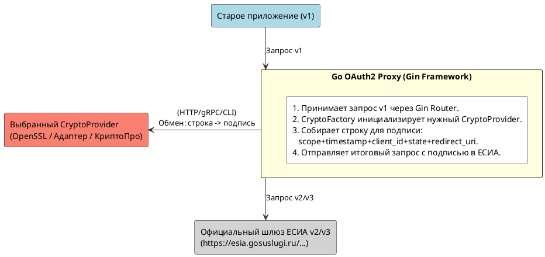
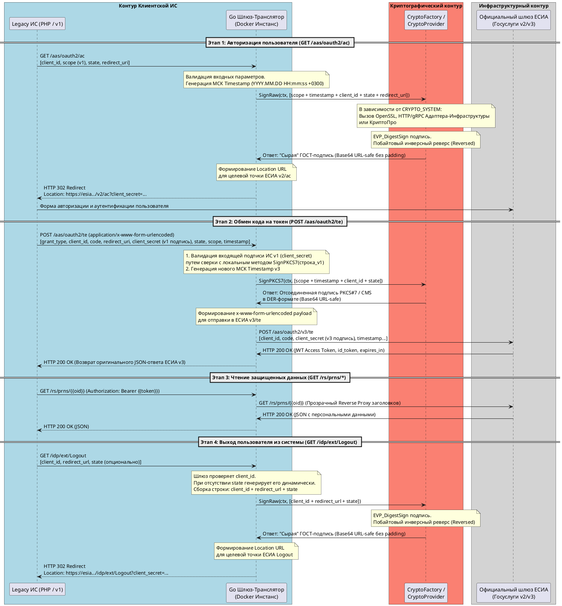

# 1. Реализация OAuth2-шлюза для ЕСИА (Госуслуги) с v1 на v2/v3

Данный документ фиксирует архитектурные решения, логику взаимодействия и требования к реализации микросервиса-транслятора на языке Go. Микросервис предназначен для бесшовного перевода существующих информационных систем (ИС) с устаревшей спецификации **ЕСИА v1** на актуальные версии **ЕСИА v2/v3** без изменения внутренней бизнес-логики самих ИС.

Так как ЕСИА v2/v3 требует подписания каждого OAuth-запроса ГОСТ-криптографией (PKCS#7 Detached Signature / ГОСТ Р 34.10-2012), в данной архитектуре криптографические операции вынесены во внешний изолированный микросервис-адаптер («сбоку») либо выполняются локально через OpenSSL.

---

## 1.1. Общая архитектура взаимодействия компонентов

Go-шлюз выступает в роли оркестратора: он принимает запросы от старого приложения, обращается к крипто-провайдеру за подписью через полиморфный интерфейс фабрики, формирует валидный запрос для ЕСИА v3 и проксирует ответ обратно. Внешний крипто-адаптер расположен изолированно («сбоку») и не взаимодействует с ЕСИА напрямую, а локальный OpenSSL работает внутри контейнера шлюза.



---

## 1.2. Фундаментальные отличия ЕСИА v2 и v3

### 1.2.1. Формат времени / таймзона
**Формат времени**: В v2/v3 строго требуется формат `YYYY.MM.DD HH:mm:ss +0300` (московское время).

### 1.2.2. Эндпоинт авторизации: `/aas/oauth2/v2/ac`
* **Формирование подписи:** Строка собирается путем конкатенации 5 параметров строго **без разделителей** в следующем порядке: `client_id + scope + timestamp + state + redirect_uri`.
* **Специфика подписи:** Требуется **«сырое» (raw)** значение подписи ГОСТ Р 34.10-2012 (без ASN.1/PKCS#7 оболочки). Полученный байтовый массив должен быть **развернут в обратном побайтовом порядке (reversed)** и закодирован в формат Base64 URL-safe (без знаков `=`).

### 1.2.3. Эндпоинт обмена токенов: `/aas/oauth2/v3/te`
* **Формирование подписи:**
  * Совпадает с алгоритмом формирования подписи v1
  * Строка собирается по классическому правилу конкатенации 4 параметров без разделителей: `scope + timestamp + client_id + state`.
  * Требуется стандартная **отсоединенная (detached) подпись PKCS#7 / CMS** в бинарном формате DER, переведенная в кодировку Base64 URL-safe.

### 1.2.4. Эндпоинт завершения сессии: `/idp/ext/Logout`
* В версии v1 не содержит подписи, и теперь в v2/v3 требуют обязательного подписания параметров
* **Формирование подписи:** Строка собирается путем конкатенации 3 параметров без разделителей: client_id + redirect_url + state.
 * **Специфика подписи:** Требуется **«сырое» (raw)** значение подписи ГОСТ Р 34.10-2012 с побайтовым разворотом в обратном порядке (reversed) и кодированием в Base64 URL-safe (то же самое, что SignRaw эндпоинта авторизации /ac).
---

# 2. Спецификация микросервиса: Шлюз-транслятор ЕСИА v1 -> v2/v3 на Go

Ниже приводится подробное техническое задание и архитектурная спецификация для разработчика микросервиса на языке Go с использованием фреймворка **Gin-Gonic**. Микросервис предназначен для бесшовного перевода существующих информационных систем (ИС) с устаревшей спецификации протокола ЕСИА v1 на актуальные версии ЕСИА v2 (авторизация `/ac`) и v3 (обмен токенов `/te`), выполняя роль прозрачного прокси-шлюза с контейнерной изоляцией, без изменения внутренней бизнес-логики самих ИС.

---

## 2.1. Архитектурная концепция и изоляция (1 инстанс = 1 клиент)

Для обеспечения максимальной безопасности, отказоустойчивости и простоты конфигурации применяется подход **один инстанс шлюза обслуживает ровно одну ИС-клиента**.
* Отсутствует общая база данных внешних ИС внутри шлюза.
* Вся конфигурация (ключи, мнемоники, сертификаты, тип криптосистемы) жестко привязана к инстансу через переменные окружения (`Environment Variables`) и монтируемые файлы (Volumes).
* Микросервис полностью имитирует домен и URL-структуру старой ЕСИА v1, благодаря чему клиентские ИС переключаются на шлюз простой сменой `host name` в своих конфигурационных файлах.

---

## 2.2. Диаграмма последовательности (PlantUML)

Диаграмма описывает сквозной жизненный цикл авторизации пользователя и обмена токенов.:



---

## 2.3. Полиморфный интерфейс `crypto.Provider`

Предполагая, что шлюз может быть использован с различными ИС, доступные криптографические движки изолируются за интерфейсом, предоставляющим два разных метода для удовлетворения требований ЕСИА v2 и v3:

```go provider.go
package crypto

import (
	"context"
)

type Provider interface {
  // SignRaw вычисляет сырую подпись ГОСТ, инвертирует массив байт (reversed) 
  // и возвращает Base64 RawURL. Предназначен для v2/ac.
  SignRaw(ctx context.Context, data string) (string, error)

  // SignPKCS7 формирует классический отсоединенный PKCS#7/CMS контейнер в DER формате
  // и возвращает Base64 RawURL. Предназначен для v3/te и проверки ИС.
  SignPKCS7(ctx context.Context, data string) (string, error)
}
```

---

### 2.3.1. Паттерн «Фабрика» и реализация оберток крипто-провайдеров на Go

Для изоляции логики подписи от главного исполняемого кода, шлюз применяет паттерн «Фабрика» крипто-провайдера. Все провайдеры-обертки должны реализовывать единый контракт (интерфейс `crypto.Provider`).

```go factory.go
package crypto

import (
  "fmt"
)

// CFactory управляет созданием экземпляров провайдеров
type Factory struct {
  cryptoSystem string
}

func NewFactory(system string) *Factory {
  if system == "" {
    system = "open-ssl-gost" // Значение по умолчанию
  }
  return &Factory{cryptoSystem: system}
}

// CreateProvider инстанцирует необходимую обертку на основе конфигурации
func (f *Factory) CreateProvider() (Provider, error) {
  switch f.cryptoSystem {
  case "open-ssl-gost":
    return &OpenSslGostProvider{
      // Параметры провайдера из OS Environment
    }, nil
  case "adapter-infra":
    return &AdapterInfraProvider{
      // Параметры провайдера из OS Environment
    }, nil
  case "crypto-pro":
    return &CryptoProProvider{
      // Параметры провайдера из OS Environment
    }, nil
  default:
    return nil, fmt.Errorf("unsupported crypto system: %s", f.cryptoSystem)
  }
}

type OpenSslGostProvider struct {
  Provider
  // Параметры провайдера
}

type AdapterInfraProvider struct {
  Provider
  // Параметры провайдера
}

type CryptoProProvider struct {
  Provider
  // Параметры провайдера
}
```

---

## 2.4. Спецификация OpenAPI 3.0.3

Ниже приведено формальное описание интерфейса шлюза, которое разработчик может использовать для генерации заглушек кода или тестирования:

```yaml
openapi: 3.0.3
info:
  title: ЕСИА Шлюз-Транслятор (v1 to v2/v3)
  description: |
    Микросервис на Go (Gin) для трансляции запросов спецификации ЕСИА v1 в формат v2/ac и v3/te.
    Обеспечивает фабричную абстракцию криптосистем и защиту сессий через подписание redirect_uri.
  version: 1.1.0
servers:
  - url: /
    description: Текущий инстанс шлюза
paths:
  /aas/oauth2/ac:
    get:
      summary: Эндпоинт авторизации (Мимикрия под v1)
      description: Принимает параметры v1, обогащает их подписью v2 через адаптер и делает 302-редирект в ЕСИА.
      parameters:
        - name: client_id
          in: query
          required: true
          schema:
            type: string
        - name: scope
          in: query
          required: true
          schema:
            type: string
        - name: response_type
          in: query
          required: true
          schema:
            type: string
            enum: [code]
        - name: redirect_uri
          in: query
          required: true
          schema:
            type: string
        - name: state
          in: query
          required: true
          schema:
            type: string
        - name: timestamp
          in: query
          required: false
          schema:
            type: string
      responses:
        "302":
          description: Редирект в официальную ЕСИА v2/ac с защищенным client_secret.
          headers:
            Location:
              schema:
                type: string

  /aas/oauth2/te:
    post:
      summary: Эндпоинт обмена кода на токен (Мимикрия под v1)
      description: Проверяет входящую PKCS#7 подпись в client_secret, генерирует новую подпись v3 через адаптер и проксирует запрос в ЕСИА v3/te.
      requestBody:
        required: true
        content:
          application/x-www-form-urlencoded:
            schema:
              type: object
              properties:
                grant_type:
                  type: string
                  enum: [authorization_code, refresh_token]
                  default: authorization_code
                client_id:
                  type: string
                code:
                  type: string
                redirect_uri:
                  type: string
                client_secret:
                  type: string
                  description: Отсоединенная подпись PKCS#7 в Base64 от старой ИС.
                scope:
                  type: string
                state:
                  type: string
              required:
                - grant_type
                - client_id
                - redirect_uri
                - client_secret
      responses:
        "200":
          description: Успешный ответ ЕСИА v3 с токенами доступа.
          content:
            application/json:
              schema:
                type: object
                properties:
                  access_token:
                    type: string
                  expires_in:
                    type: integer
                  token_type:
                    type: string
                    example: Bearer
                  id_token:
                    type: string
        "400":
          description: Ошибка валидации параметров или неверная подпись ИС.
          content:
            application/json:
              schema:
                type: object
                properties:
                  error:
                    type: string
                  error_description:
                    type: string

  /idp/ext/Logout:
    get:
      summary: Эндпоинт выхода из системы (Мимикрия под v1 Logout)
      description: Перехватывает GET-запрос выхода старой ИС, формирует reversed ГОСТ-подпись v2 из параметров client_id, redirect_url, state и перенаправляет пользователя в ЕСИА.
      parameters:
        - name: client_id
          in: query
          required: true
          schema:
            type: string
        - name: redirect_url
          in: query
          required: true
          schema:
            type: string
        - name: state
          in: query
          required: false
          schema:
            type: string
      responses:
        "302":
          description: Успешный редирект на официальный эндпоинт выхода ЕСИА с валидным client_secret.
```

---

## 2.4. Спецификация входящих эндпоинтов (Мимикрия под v1)
Микросервис должен обрабатывать следующие эндпоинты в точном соответствии со структурой ЕСИА v1, используя методы `Gin-Gonic`.

### 2.4.1. Точка авторизации: `GET /aas/oauth2/ac`
* **Формат запроса:** URL Query Parameters.
* **Входящие параметры v1:** `client_id`, `scope`, `response_type`, `redirect_uri`, `state`, `timestamp` (опционально в v1).
* **Логика обработки:**
    1. Проверить совпадение входящего `client_id` со значением из переменной окружения `GATEWAY_CLIENT_ID`.
    2. **Контроль целостности:** Извлечь из параметра `client_secret` подпись v1. Восстановить исходную строку подписи v1 на базе параметров запроса и верифицировать её с помощью публичного сертификата ИС. Если подпись невалидна — вернуть `HTTP 400 Bad Request`.
    3. В случае успешной валидации старая подпись отбрасывается.
    4. Проверить значение временной метки `timestamp`
       4.1. если метка отсутствует (например, в случае старой системы) - сгенерировать новую с текущим временем в формате: `yyyy.MM.dd HH:mm:ss Z` (например, 2013.01.25 14:36:11 +0400).
      4.2. значение метки не должно отличаться от системного времени более чем на +/- 5 минут (проверка Time Skew)
    5. Сформировать строку для подписи v2 (включая поддержу защиты атак `redirect_uri`): `client_id + scope + timestamp + state + redirect_uri` (без разделителей).
    6. Вызвать полиморфный метод `SignRaw` текущего провайдера, полученного из `CryptoFactory`.
    7. Передать Base64 URL-safe подпись в параметр `client_secret` для новой ЕСИА.
    8. Сформировать редирект на целевой URL ЕСИА v2: `https://{{ESIA_TARGET_HOST}}/aas/oauth2/v2/ac`.
* **Формат ответа:** `HTTP 302 Found` с перенаправлением пользователя.

### 2.4.2. Точка обмена токенов: `POST /aas/oauth2/te`
* **Формат запроса:** `application/x-www-form-urlencoded`.
* **Входящие параметры v1:**
    * `grant_type` (строго `authorization_code` или `refresh_token`)
    * `client_id` (мнемоника системы)
    * `code` (код авторизации, полученный от ЕСИА)
    * `redirect_uri` (должен совпадать с зарегистрированным в ЕСИА)
    * `client_secret` (**Важно:** в протоколе v1 здесь передается отсоединенная подпись PKCS#7 самой ИС, наложенная на строку авторизации v1).
    * `scope` (опционально, запрашиваемые права).
    * `state`.
* **Логика обработки:**
    1. **Контроль целостности:** Извлечь из параметра `client_secret` подпись v1. Восстановить исходную строку v1 на базе параметров запроса и верифицировать её с помощью публичного сертификата ИС. Если подпись невалидна — вернуть `HTTP 400 Bad Request`.
    2. В случае успешной валидации старая подпись отбрасывается.
    3. Проверить значение временной метки `timestamp`
       3.1. если метка отсутствует (например, в случае старой системы) - сгенерировать новую с текущим временем в формате: `yyyy.MM.dd HH:mm:ss Z` (например, 2013.01.25 14:36:11 +0400).
       3.2. значение метки не должно отличаться от системного времени более чем на +/- 5 минут (проверка Time Skew)
    4. Сформировать новую строку для подписи v1: `scope + timestamp + client_id + state` (без разделителей).
    5. Вызвать полиморфный метод `SignPKCS7` текущего провайдера, полученного из `CryptoFactory`.
    6. Сформировать новый URL-encoded payload и выполнить POST-запрос к официальному эндпоинту ЕСИА: `https://{{ESIA_TARGET_HOST}}/aas/oauth2/v3/te`.
* **Формат ответа:** Трансляция ответа ЕСИА v3 в исходную ИС (`HTTP 200 OK` с JWT JSON-структурой, содержащей `access_token`, `id_token` и `expires_in`).

### 2.4.3. Проксирование `GET /idp/ext/Logout`
* Перехватывает запрос выхода
* Проверяет легитимность мнемоники
* Осуществляет HTTP 302 Redirect на обновленный защищенный эндпоинт выхода ЕСИА v2 `/aas/oauth2/api/logout`.

### 2.4.4. Проксирование REST-ресурсов: `GET /rs/prns/*` и `GET /rs/orgs/*`
* **Логика обработки:** Чистый Reverse Proxy с использованием `access_token`.
* Подпись ГОСТ на данном этапе не требуется.
* Шлюз перенаправляет входящий запрос на `https://{{ESIA_TARGET_HOST}}/rs/prns/*` (или `/orgs/*`), сохраняя все HTTP-заголовки, включая `Authorization: Bearer <token>`.
* **Агрегация UserInfo**:
  * В ЕСИА v1 профиль пользователя мог отдаваться одним ответом. В v3 данные разбиты на отдельные эндпоинты (`/ctc` — контакты, `/elements` — документы и т.д.). В прокси потребуется реализовать паттерн **API Gateway / Aggregator**, который выполнит параллельные запросы к ЕСИА v3, соберет сущности и склеит их в старый формат, ожидаемый вашей системой.

---

## 2.5. Конфигурационная матрица параметров (Environment Variables)

Инстанс шлюза настраивается через системные переменные окружения. Выбор провайдера определяется переменной `CRYPTO_SYSTEM`.

### 2.5.1. Базовые параметры шлюза
* `LOG_LEVEL` — "DEBUG", [по умолчанию] `"INFO"`, "WARN" / "WARNING", "ERROR".
* `LOG_HANDLER` — [по умолчанию] `"json"` (для prod/ELK), "text" (для dev/тестов).
* `GATEWAY_CLIENT_ID` — Мнемоника ИС в ЕСИА (например, `019110`).
* `ESIA_TARGET_HOST` — Целевой хост ЕСИА (продуктив или тест).
* `HTTP_LISTEN_PORT` — Порт прослушивания Gin (по умолчанию `:8080`).
* `ESIA_UPSTREAM_TIMEOUT` — Таймаут сетевых вызовов к ЕСИА в секундах.

### 2.5.2. Параметры криптосистем

| Значение `CRYPTO_SYSTEM` | Зависимая переменная | Описание |
| :--- | :--- | :--- |
| **`open-ssl-gost`** | `OPENSSL_KEY_PATH` | Путь к файлу закрытого ГОСТ-компонента ключа ИС (`ca.key`) |
| | `OPENSSL_KEY_PASSWORD` | Пароль для доступа к файлу закрытого ГОСТ-компонента ключа ИС (`ca.key`) |
| | `OPENSSL_CERT_PATH` | Путь к файлу публичного ГОСТ-сертификата ИС (`ca.crt`) |
| **`adapter-infra`** | `CRYPTO_ADAPTER_URL` | Сетевой адрес ПО «Адаптер Инфраструктура» (REST/gRPC) |
| | `CRYPTO_ADAPTER_KEY_ID`| Идентификатор/Алиас ключа ГОСТ в хранилище Адаптера |
| **`crypto-pro`** | `CRYPTO_ADAPTER_URL`| Точка интеграции с внешним сервисом КриптоПро CSP |

*Примечание: Для режима `open-ssl-gost` вызовы осуществляются в памяти процесса с использованием **CGO** и линковки пакета `pkg-config: libcrypto`. Переменные конфигурации путей CLI удалены.*

---

# 3. Нефункциональные требования

## 3.1. Соответствие требованиям 152-ФЗ (Персональные данные)
* **Запрет логирования ПДн:** Категорически запрещено выводить в `stdout`/`stderr` контейнера содержимое ответов от эндпоинтов `/rs/prns/*` и `/rs/orgs/*`.
* Эти данные содержат чувствительную персональную информацию граждан (СНИЛС, паспортные данные, контакты).
* Встроенные Middleware логирования Gin должны быть настроены на игнорирование тела ответов данных эндпоинтов.


## 3.2. Логирование
**Техническое логирование:** В лог разрешено отправлять:
* Время выполнения запроса, метод, путь и итоговый HTTP-статус ответа ЕСИА.
* Ошибки валидации подписи исходной ИС (без вывода параметров секретов в открытый лог).
* Ошибки инициализации фабрики и исполнения методов `Sign*` крипто-провайдеров.

## 3.3. Стратегия масштабирования
Каждый экземпляр шлюза полностью автономен (stateless).

1. Рекомендуется использовать несколько экземпляров (минимум 2) для каждого Docker-микросервиса и обеспечивать балансирование запросов:
    * В случае использования Docker Compose: Nginx / Traefik в качестве входящего (front-end) балансировщика.
    * В случае использования Kubernetes (k8s): Встроенные средства балансировки абстракции Service над Pod-ами.
2. **Таймауты**: Поскольку цепочка вызовов увеличивается (`Приложение -> Шлюз (Gin) -> Криптобиблиотека/Адаптер -> Шлюз -> ЕСИА`), обязательно выставляйте жесткие контекстные таймауты (`context.WithTimeout`) на каждый вызов методов `Sign*` крипто-провайдеров.
```go

	// Вызов полиморфного метода подписи через контракт интерфейса
	ctx, cancel := context.WithTimeout(context.Background(), 5*time.Second)
	defer cancel()

	// Собираем 5 параметров БЕЗ разделителей для ЕСИА v2/ac
	// Порядок строго по МР ЕСИА: client_id + scope + timestamp + state + redirect_uri
	v2StringToSign := scope + timestamp + s.ClientID + state + redirectURI

	// Вызываем разделенный метод SignRaw для сырой reversed-подписи
	v2ClientSecret, err := s.CryptoProvider.SignRaw(ctx, v2StringToSign)
	if err != nil {
		c.JSON(http.StatusInternalServerError, gin.H{"error": "crypto_failed", "details": err.Error()})
		return
	}

```